# LeapQuant：8 位循环状态量化近无损，线性注意力内核最高提速 3.7 倍

> 原创 UCB, UW, MIT 等 · NeuralTalk · 2026 年 10 月 4 日 · 上海
>
> 关键词：线性注意力、循环状态量化、窗口量化、补偿 Token、长上下文推理

**LeapQuant：实现近无损的递归状态量化** · NeuralTalk · 20 分钟

对采用混合架构的长上下文大模型而言，循环状态的读写开销占据了解码时间的相当大比例，同时也是前缀缓存场景下的核心显存消耗项。

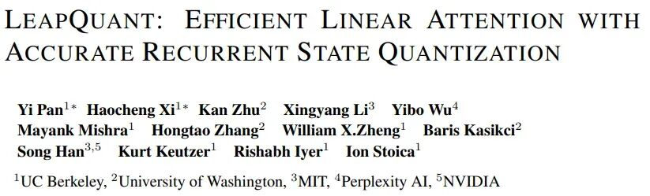

- **LeapQuant: Efficient Linear Attention with Accurate Recurrent State Quantization**
- 组织机构：加州大学伯克利分校、华盛顿大学、麻省理工学院、Perplexity AI、英伟达
- 论文链接：https://arxiv.org/pdf/2609.38166

**LeapQuant：实现近无损的递归状态量化** · NeuralTalk · 20 分钟

**相关推荐**

- **Qwen3-Next 实测性能暴涨！KVBuffer：IO 感知的线性注意力服务机制**
- **从 MegaKernel 视角重新定义 NPU 上的线性注意力极限！PTO-ISA 驱动的昇腾 NPU Gated DeltaNet MegaKernel 浅析**
- **FP4 Explore, BF16 Train：扩散强化学习的效率革命——4.64 倍加速背后的算法-硬件协同设计。假量化之名，行解耦之实**

这项工作试图解决的核心问题，是线性注意力循环状态的低比特量化难题。**传统朴素的逐 token 量化方案，会因为循环迭代的误差累积与状态矩阵的严重离群值，导致模型精度大幅退化，甚至完全失效**。**LeapQuant 的核心洞察在于，从减少量化次数和降低单次量化误差两个维度同时切入，用逐窗口量化抑制误差累积，用补偿 Token 加残差平滑处理离群值问题。**

实验结果显示，这套完全免训练的方案在 **8 位量化下精度与 FP32 基线相当，状态内存流量降低 3.4 倍，端到端显存占用最高下降 56%**；在 NVIDIA B200、RTX PRO 6000 和 RTX 5090 GPU 上，**内核级平均加速 2.05–3.70 倍，端到端推理平均加速 1.47 倍**。

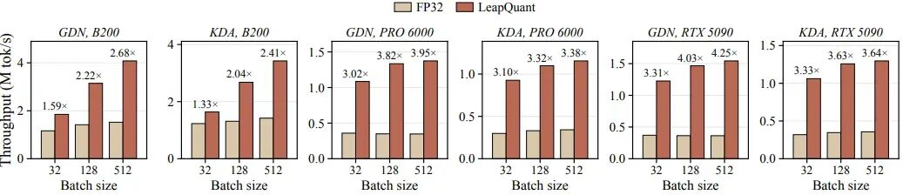

图 7：单个线性注意力层的内核吞吐量。该图展示了内核层面的吞吐量提升效果，覆盖三款 GPU 与两种线性注意力架构。LeapQuant 在所有配置下都实现了 2 倍以上内核加速，越新的 GPU 加速效果越明显，因为新一代 GPU 的算力增长远快于内存带宽增长，状态访问的带宽瓶颈更突出，量化减少内存访问的收益就更大。内核级的大幅加速是端到端推理性能提升的基础，也验证了方案在底层计算层面的效率优势。

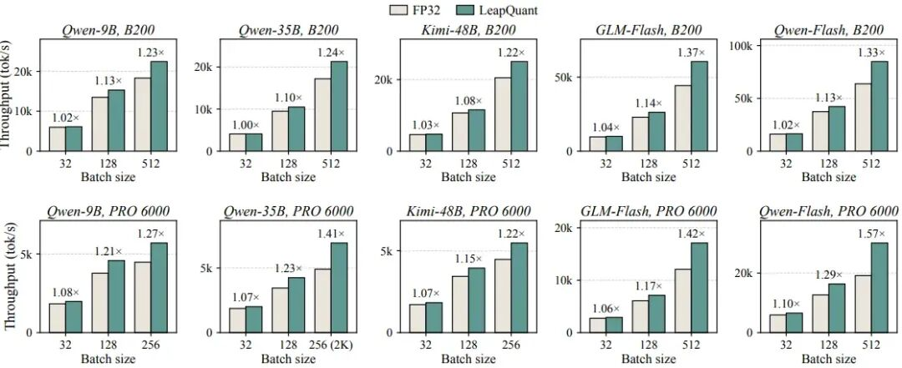

图 8：上下文长度为 4K 时，vLLM 中的解码步吞吐量。在 RTX PRO 6000 上，最大批次为 256（512 无法适配显存），且该批次下 Qwen3.5-35B-A3B 使用 2K 上下文而非 4K。该图展示了完整模型层面的解码步加速效果，覆盖不同参数量模型与不同硬件。LeapQuant 在所有配置下都实现了正向加速，且批次越大加速效果越显著，因为大批次下线性注意力的状态访问占总耗时比例更高，内存带宽瓶颈更突出。不同模型的加速差异体现了架构特性的影响，GDN 与 KDA 两种主流变体都能适配该方案，证明了方法的架构通用性。

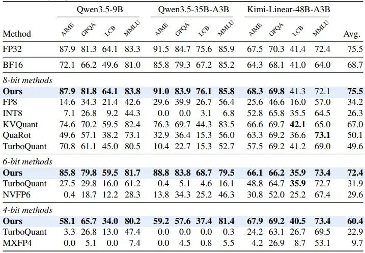

表 1：下游任务性能对比，数值越高越好。8 位、6 位、4 位各组内的最优成绩已加粗。8 位下 LeapQuant 在 12 个模型任务对上的平均精度和 FP32 基线完全持平，而朴素的 FP8、INT8 量化精度暴跌，哪怕是适配后的 KVQuant、TurboQuant 等基线也有明显差距。6 位和 4 位下优势更加明显，基线方法基本已经失效，而 LeapQuant 依然能保持很高的精度水平。

对于当下快速普及的混合架构长上下文模型，这项工作补上了推理服务端的关键一块，具备极高的落地价值。

## 本文目录

- 一、线性注意力的推理瓶颈：为什么循环状态量化是必答题
    - 1.1 循环状态的本质与访存特性
    - 1.2 双重瓶颈：解码带宽与前缀缓存显存
- 二、两大核心痛点：为什么朴素量化在循环状态上行不通
    - 2.1 痛点一：循环迭代导致误差持续累积
    - 2.2 痛点二：状态离群值放大单次量化误差
- 三、LeapQuant 核心设计一：逐窗口量化，从根源抑制误差累积
    - 3.1 逐窗口量化的工作流程
    - 3.2 误差收益远超线性比例
    - 3.3 窗口大小的权衡
- 四、LeapQuant 核心设计二：补偿 Token+残差平滑，击穿离群值量化难题
    - 4.1 补偿 Token：高精度保留主导结构
    - 4.2 残差平滑：拉平通道幅值分布
- 五、全维度实验验证：精度、速度、显存的三重提升
    - 5.1 下游任务精度：8 位完全追平 FP32
    - 5.2 推理效率与显存收益
    - 5.3 消融实验：每个组件的明确贡献
- 六、总结与展望：线性注意力量化的落地意义与未来方向
    - 6.1 产业落地的核心价值
    - 6.2 未来的优化方向

## 一、线性注意力的推理瓶颈：为什么循环状态量化是必答题

随着长上下文大模型成为行业标配，传统 softmax 注意力的平方级复杂度越来越难以支撑百万级 token 的推理需求，线性注意力凭借固定大小的循环状态，将上下文压缩成本从平方级拉到了线性级。

从 Qwen 的 Gated DeltaNet 到 Kimi 的 Delta Attention，再到 GLM 的 Flash 架构，**当下主流的长上下文大模型几乎都采用了"少量标准注意力+大量线性注意力"的混合设计**。**线性注意力层的占比越来越高，其推理效率直接决定了整个模型的服务成本与用户体验。**

### 1.1 循环状态的本质与访存特性

线性注意力的核心逻辑，是将历史所有 token 的上下文信息压缩成一个固定尺寸的矩阵，也就是循环状态。每生成一个新的 token，模型会生成对应的 key 向量和 value 向量，用它们更新循环状态，再用 query 向量读取状态得到当前 token 的输出。

这个更新过程可以用统一的递推公式表示（其中 α 是对角衰减矩阵，用来控制历史信息的遗忘速度；β 是读取向量，对应 delta 规则的校正项，没有 delta 规则的模型该值为 0）。

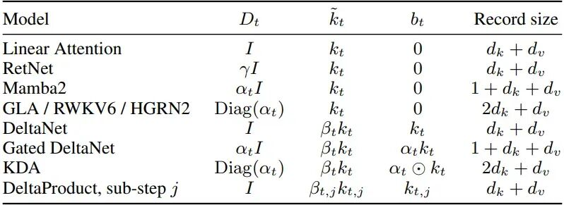

表 4：递推公式的不同模型实例。DeltaProduct 每个 token 应用 n 个 delta 规则子步骤，每个子步骤都符合递推公式的形式。最后一列给出单次缓存更新包含的数值数量。该表展示了 LeapQuant 的架构通用性，主流线性注意力变体包括标准线性注意力、RetNet、Mamba2、GDN、KDA 等，都可以统一到同一个状态更新公式下。这意味着整套量化框架可以直接适配所有这些架构，不需要针对每个模型单独设计量化逻辑。不同模型的单条缓存更新大小略有差异，但都可以复用相同的推理内核，证明了方法的普适性，能够覆盖当前主流的长上下文大模型架构。

循环状态就像一个不断更新的记忆笔记本，大小是固定的，不会因为上下文变长而增厚。这是线性注意力长上下文优势的来源，但也带来了新的推理瓶颈。

### 1.2 双重瓶颈：解码带宽与前缀缓存显存

**循环状态的更新是典型的访存密集型操作**。每生成一个 token，都需要把完整的状态矩阵从 HBM 中读取出来，完成轻量的更新计算后，再写回 HBM。整个过程的计算量很小，但数据读写量很大，根据 RoofLine 模型，吞吐量完全被 HBM 带宽限制，计算单元无法被充分利用。

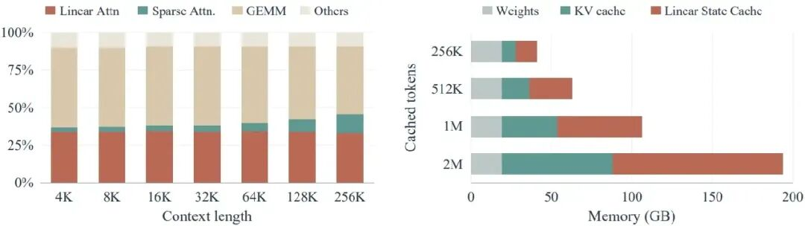

图 1：循环状态访问是 LLM 服务的主要成本。左图为 B200 GPU 上批量大小 256 时 GLM-5.3-Flash-NVFP4 的解码时间拆分，线性注意力的时间占比随上下文长度增长基本保持恒定；右图为启用前缀缓存时 Qwen3.5-9B 的 GPU 显存占用，假设每 1024 个缓存 token 对应一个线性注意力状态。从时间维度看，线性注意力是解码阶段的核心开销之一，且不会随上下文变长而占比下降；从显存维度看，前缀缓存下循环状态会随缓存 token 数线性增长，成为长上下文服务的主要显存消耗项。这也意味着优化循环状态的存储与访问，能同时带来解码速度提升与显存占用下降。

除了解码阶段的带宽瓶颈，前缀缓存场景下的显存压力同样突出。现在的推理服务框架普遍支持前缀缓存，将公共前缀的计算结果保存下来，避免重复计算。**对线性注意力来说，每个前缀都需要保存一份完整的循环状态，缓存的前缀越多、上下文越长，状态缓存占用的显存就越大。**

总之，**线性注意力的循环状态既是长上下文推理的核心优势载体，也是当下服务端的访存与显存双重瓶颈**。对循环状态进行低比特量化是提升推理效率的必经之路，但必须解决循环结构特有的精度退化问题。

## 二、两大核心痛点：为什么朴素量化在循环状态上行不通

很多人会觉得，权重能做 4 位量化，KV 缓存能做 8 位量化，**循环状态不就是个矩阵，直接量化不就行了？但实际测试的结果恰恰相反**，**哪怕是 BF16 的逐 token 量化，都会在长推理链上出现明显的精度下滑，8 位直接就没法用了。**

造成这种现象的根源在于两个特有的误差来源：一是循环结构带来的误差累积效应，二是状态矩阵中严重的行/列离群值问题。这两个问题是循环状态与生俱来的属性，也是所有现有量化方案直接套用失效的核心原因，下面我们逐一看看。

### 2.1 痛点一：循环迭代导致误差持续累积

权重量化和 KV 缓存量化都是一次性的：权重量化后就固定不变，KV 缓存写入后也只会被读取，不会反复修改。**但循环状态不同，它是每一步迭代更新的，上一步的输出是下一步的输入。**

如果采用逐 token 的量化方式，每生成一个 token，就要对状态做一次量化，引入一次舍入误差。**这个误差会被带入下一步的更新计算，下一步更新完成后再量化，又叠加新的误差。随着生成的 token 越来越多，误差会像滚雪球一样越积越大**，最终导致状态严重偏离 FP32 的正确轨迹，模型精度大幅下降。

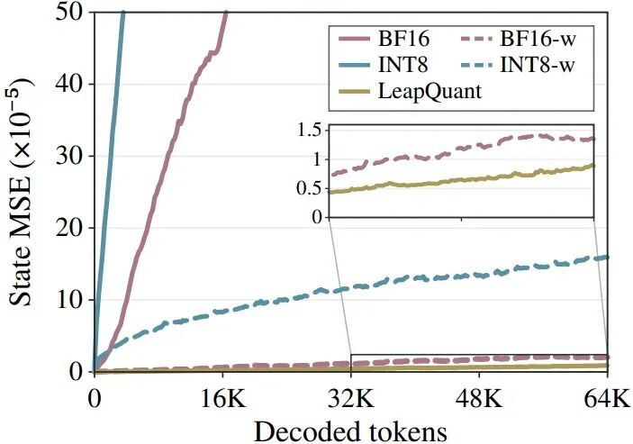

图 3：Qwen3.5-9B 在 PG-19 数据集上 64K 解码 token 过程中的状态均方误差。其中带 -w 后缀的是每窗口量化一次的版本，其余为逐 token 量化。可以看到逐 token 量化下，哪怕是 BF16，误差也会随上下文长度稳步增长，INT8 更是快速发散；而每 16 个 token 量化一次的窗口版本，BF16 的 64K 误差降低了 100 倍，INT8 降低了 39 倍。这直观证明了量化频率是误差累积的核心决定因素，减少量化次数能大幅降低长上下文下的状态偏差。

如上图所示，在 64K token 的生成长度下，逐 token 的 BF16 量化误差已经非常明显，INT8 更是直接发散。**而思考链越长的任务，比如数学推理、代码生成，误差累积的影响就越严重，精度下降也越夸张。**

### 2.2 痛点二：状态离群值放大单次量化误差

除了时序上的误差累积，空间上的数值分布不均也是一大难题。循环状态矩阵中的数值分布极不均匀，少数几行和几列的数值远大于其他位置，也就是存在严重的离群值。

**量化的动态范围由矩阵中的最大值决定，离群值会大幅拉宽量化范围，导致绝大多数小数值只能分配到很少的量化档位，精度损失被严重放大**。这个问题在权重和激活量化中也存在，**但循环状态的离群值更集中，且会随着迭代持续存在，每一次量化都会重复放大这个误差。**

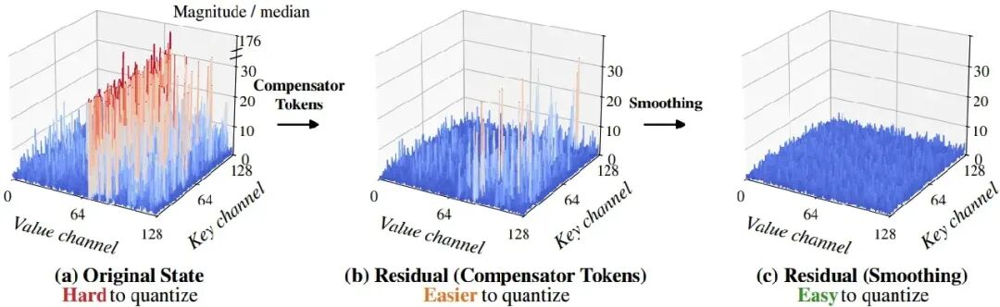

图 6：Qwen3.5-9B 第 13 层第 16 头在 8K 上下文下的状态幅值分布，以状态中位数为归一化基准。左图是原始状态，离群值最高达到中位数的 176 倍；中间是去掉补偿 Token 后的残差，离群值降到 47 倍；右图是平滑后的残差，离群值仅为 5.3 倍。离群值的存在会大幅拉宽量化范围，让绝大多数小数值的量化精度严重受损，这也是单次量化误差的主要来源。

回顾一下，**循环状态量化的两大核心障碍分别是循环迭代带来的误差累积与状态离群值导致的单次量化误差过大**。**前者是时序上的问题，后者是空间上的问题，两者共同作用导致朴素量化方案完全失效。LeapQuant 的设计思路正是从这两个维度分别切入，逐个击破。**

## 三、LeapQuant 核心设计一：逐窗口量化，从根源抑制误差累积

既然逐 token 量化的最大问题是每一步都引入新误差，那最直接的思路就是降低量化的频率。**LeapQuant 提出的逐窗口量化，就是把连续的 p 个 token 分成一个窗口，整个窗口内只在开始和结束的时候做两次状态量化**，中间的 token 都用高精度缓存更新，不碰量化后的主状态。

这个思路听起来简单，但背后是对线性注意力递推结构的深度利用。线性注意力本身就支持分块计算的形式，训练和预填充阶段本来就是按块处理的，**逐窗口量化相当于把这个分块思想延伸到了解码阶段的量化流程里。**

### 3.1 逐窗口量化的工作流程

逐窗口量化的核心逻辑，是将 p 个连续的 token 划分为一个处理窗口。窗口起始时保留一个量化后的边界状态，作为整个窗口的基准。窗口内的每一个 token，都不直接更新主状态，而是将对应的衰减系数、key 向量和校正向量以高精度形式缓存起来。

计算窗口内第个 token 的输出时，不需要完整的量化状态，而是通过边界状态和缓存的更新项直接推导（其中 Γ 是从第 1 步到第 ℓ 步的累积对角衰减）。

**这个公式的含义是，窗口内任意时刻的状态，等于起始边界状态经过累积衰减后，叠加前面所有 token 更新项的衰减结果。** 整个过程中，起始的量化状态保持不变，中间所有更新都以高精度向量的形式缓存，不会引入额外的量化误差。

只有当窗口内所有 p 个 token 都处理完成后，才会重建出完整的高精度状态，并量化一次得到下一个窗口的边界状态。**这样一来，每 p 个 token 才会引入一次量化误差，量化频率降低了 p 倍。**

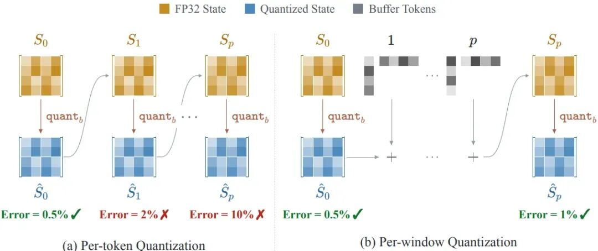

图 2：逐 token 量化与逐窗口量化的对比。左图逐 token 量化每次更新后都重新量化完整状态，每步都引入新误差；右图逐窗口量化保持量化边界状态固定，窗口内的 p 次更新用高精度缓存，仅在窗口结束时量化一次完整状态。逐窗口量化将量化频率降低了 p 倍，更重要的是避免了每步小更新被反复量化截断的问题，误差降低的幅度远大于量化频率降低的比例。

### 3.2 误差收益远超线性比例

逐窗口量化带来的精度提升，远不止是量化频率降低 p 倍那么简单。逐 token 量化时，每一步的更新量本身很小，量化的舍入会直接截断这部分小增量的精度，相当于每一步都丢失一点细节。这些误差是相干叠加的，长序列下会快速累积放大。

**而逐窗口量化是将 p 步的小更新汇总成一个总增量，再进行一次量化。中间的所有小更新都保留了完整精度，不会被反复截断，因此误差降低的幅度远大于 p 倍。** 论文中的实验也验证了这一点：16 窗口的 INT8 量化，误差比逐 token 降低了 39 倍，远超 16 倍的线性比例。

### 3.3 窗口大小的权衡

窗口大小 p 的选择需要在精度和性能之间做平衡。

- 窗口太小，量化依然频繁，误差抑制效果有限，且频繁重建状态会增加计算开销；
- 窗口太大，缓存的更新向量太多，每步计算输出时需要读取的缓存数据量上升，反而会增加访存开销，抵消量化带来的收益。

论文通过消融实验确定为最优值，此时精度基本饱和，内核性能也达到峰值。

整体看下来，**逐窗口量化是 LeapQuant 最核心的基础设计，它用窗口内的高精度缓存更新换取量化频率的大幅降低，从根源上抑制了循环状态的误差累积问题**。这个设计**完全复用了线性注意力本身的分块计算特性**，没有引入额外的模型修改，是典型的四两拨千斤的优化思路。

## 四、LeapQuant 核心设计二：补偿 Token+残差平滑，击穿离群值量化难题

逐窗口量化解决了误差累积的问题，但窗口结束那次量化本身的误差还在。**如果状态矩阵里有大量离群值，哪怕只量化一次，误差也会大到无法接受。LeapQuant 用两步组合拳来解决这个问题：先用补偿 Token 吃掉最大的离群分量，再用残差平滑拉平剩余的数值分布。**

**这两项技术的目标只有一个：让要量化的残差矩阵数值尽可能均匀，从而在相同比特数下获得更高的量化精度**。其中补偿 Token 负责处理大头的低秩离群结构，残差平滑负责处理剩余的通道间不均衡。

### 4.1 补偿 Token：高精度保留主导结构

补偿 Token 的核心思想，是在量化之前先从状态矩阵中拆出几个能量最高的秩一分量，用高精度单独保存，剩下的残差再进行低比特量化。

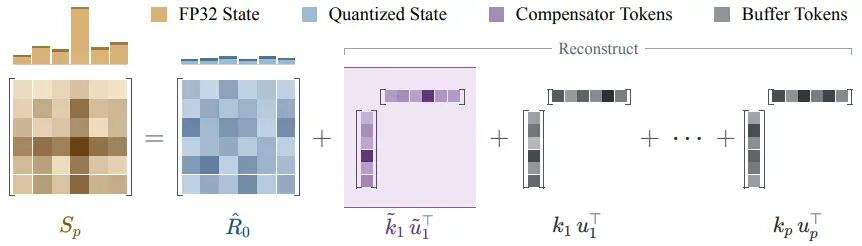

图 4：带补偿 Token 的逐窗口状态重建。FP32 精度的状态被拆分为低比特量化残差、少量捕获状态主导大数值结构的高精度补偿 Token，以及窗口内缓存的真实 token 更新。补偿 Token 吸收了主要的离群值，拉平了残差的行 L2 范数，降低了量化难度。该图展示了补偿 Token 的工作原理与状态拆分结构。补偿 Token 本质是用少量秩一矩阵捕捉状态中的主导大数值分量，将其保留为高精度，仅对残差进行低比特量化。由于线性注意力的状态更新本身就是秩一形式，补偿 Token 可以直接复用现有的 token 更新路径，不需要额外计算分支，工程实现开销极低。该设计针对性解决了离群值导致量化范围过大的问题，是低比特量化保持精度的核心技术。

具体来说，在窗口结束重建出高精度状态后，通过幂迭代拟合出 r 个秩一矩阵，这些分量对应状态矩阵的前 r 个奇异成分，承载了状态的绝大部分能量。将这些分量从原始状态中减去，得到的残差矩阵动态范围会大幅缩小，再进行量化时的误差就会显著降低。

**之所以称为补偿 Token，是因为这些秩一分量的形式和真实 token 的更新项完全一致。** 在下一个窗口中，它们可以直接放在真实 token 更新的最前面，走完全相同的计算通路，不需要修改内核逻辑，也不需要额外的状态存储结构。

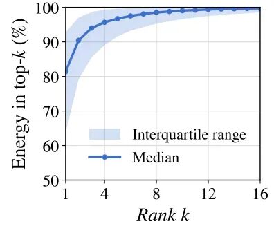

图 5：Qwen3.5-9B 模型中状态矩阵前 k 个奇异值的能量占比。可以看到前几个奇异值就承载了状态的绝大部分能量，中位数显示前 12 个奇异值就能覆盖超过 80% 的能量。这意味着只需要很少的补偿 Token，就能捕捉状态里的主要结构，剩下的残差能量低、分布均匀，非常适合低比特量化。

**论文实验显示，个补偿 Token 时精度就已经饱和，继续增加数量不会带来精度提升**，反而会增加计算开销。时，补偿 Token 的拟合计算可以和显存读取完全重叠，内核级开销控制在 7% 以内，几乎可以忽略。

### 4.2 残差平滑：拉平通道幅值分布

补偿 Token 移除了主导的低秩结构后，剩余的残差矩阵依然存在行与行之间的幅值不均。少数幅值较大的行依然会拉宽整体量化范围，造成其他行的量化精度浪费。

**残差平滑通过一个可逆的通道缩放变换，进一步拉平残差的行幅值分布。** 具体做法是，对残差的每一行计算其绝对值均值的平方根，作为该行的缩放系数。用缩放系数的逆去乘对应行，让大的行缩小、小的行放大，使所有行的幅值处于相近的水平。

量化完成后，再通过对应的缩放系数恢复原始的数值尺度。整个变换是完全可逆的，只有量化步骤会引入近似。缩放系数本身用 FP32 存储，开销极低，且每个窗口更新一次即可。

经过补偿 Token 和残差平滑的两步处理，原始状态中 176 倍于中位数的离群值会被压缩到 5.3 倍，残差的数值分布变得非常均匀，量化精度得到了质的提升。

**总之，补偿 Token+残差平滑的组合，从低秩结构和通道均衡两个维度压缩了量化对象的动态范围**，在几乎不增加额外开销的前提下，大幅降低了单次窗口量化的误差。这两项技术和逐窗口量化配合，最终实现了 8 位量化下的近无损精度。

## 五、全维度实验验证：精度、速度、显存的三重提升

LeapQuant 的效果到底怎么样，最终还是要靠实验数据说话。**论文在 Qwen、Kimi、GLM 三大模型系列上做了全面的测试，覆盖了从下游任务精度、内核速度、解码吞吐量到显存占用的全维度指标**，还做了详细的消融实验验证每个组件的作用。

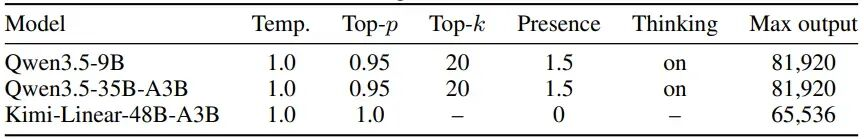

表 6：下游评估的生成参数设置。该表明确了所有精度实验的生成配置，同一模型下所有量化方法使用完全一致的采样参数、提示词与样本集合，确保对比实验的公平性与结果可信度。其中 Qwen 系列模型开启思考模式，最大输出长度可达 8 万余 token，这种长生成场景恰好是量化误差累积最严重的场景，也最能体现 LeapQuant 的误差控制优势。Kimi 为纯指令模型无思考模式，输出长度相对更短，实验结果也验证了方案在不同输出长度场景下的适应性。

**所有实验都和 vLLM 的 FP32 状态实现做对比**，硬件覆盖了 NVIDIA B200、RTX PRO 6000 和 RTX 5090 三张不同定位的 GPU。

### 5.1 下游任务精度：8 位完全追平 FP32

论文在 AIME 2026、GPQA-Diamond、MMLU-Pro、LiveCodeBench、GSM8K 等多个基准上测试了模型精度，覆盖了数学推理、知识问答、代码生成等多种任务。

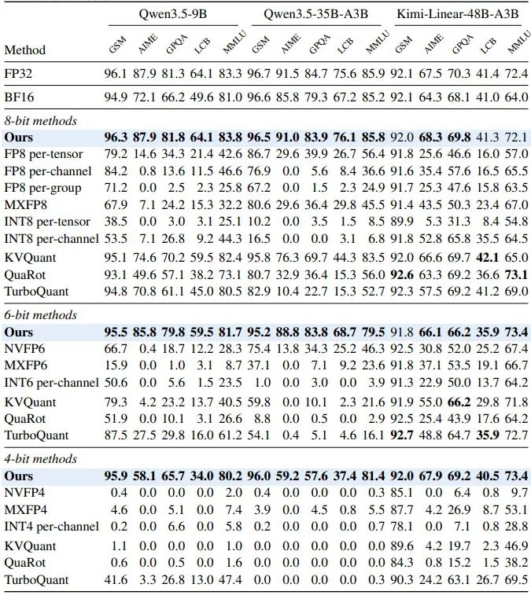

表 5：完整下游任务性能（单位：%，数值越高越好）。每个比特宽度组内每列的最优成绩以粗体标注。该表补充了 GSM8K 任务与更多基线方法的完整对比，进一步验证了 LeapQuant 的精度优势。所有传统逐 token 量化方法在 8 比特以下都出现严重精度衰减，尤其长推理链的 AIME 任务上准确率几乎归零；而 LeapQuant 在所有任务、模型、比特宽度下都大幅领先基线。补充的多粒度量化格式对比也表明，单纯调整量化粒度无法解决线性注意力状态的量化误差问题，必须结合误差累积抑制与离群值处理机制，才能同时兼顾精度与效率。

**8 位量化下，LeapQuant 在 12 个模型任务对上的平均精度达到 75.5%，和 FP32 基线完全一致。** 而朴素的逐 token FP8 量化平均分仅 34.2%，INT8 仅 26.3%，基本丧失了任务能力。哪怕是将 KV 缓存的量化方法适配到循环状态，表现最好的 KVQuant 也只有 67.0%，和 LeapQuant 有 8.5 个百分点的差距。

**在长推理任务上差距更为显著**。以 Qwen3.5-9B 的 AIME 数学任务为例，FP32 精度为 87.9%，逐 token BF16 就掉到 72.1%，逐 token INT8 只剩 7.1%，而 **LeapQuant 的 8 位结果依然是 87.9%，和 FP32 完全持平**。这是因为长思考链下误差累积效应被放大，朴素量化崩得最彻底，也最能体现 LeapQuant 的核心价值。

**在更低的 6 位和 4 位比特下，LeapQuant 的优势更加突出。** 6 位时基线方法平均分仅 30% 左右，LeapQuant 达到 72.4%；4 位时基线方法基本跌到个位数，LeapQuant 依然保持 60.4% 的平均分，且在 Kimi 模型上和 FP32 的差距不超过 1.1%。

### 5.2 推理效率与显存收益

内核层面，单层线性注意力的吞吐量提升非常显著。在批量大小 512 时，GDN 架构上 LeapQuant 在 B200、RTX PRO 6000、RTX 5090 上分别达到 2.68 倍、3.95 倍、4.25 倍加速；KDA 架构上分别达到 2.41 倍、3.38 倍、3.64 倍加速。

解码层面，4K 上下文下 B200 的解码吞吐量提升 1.22–1.37 倍，RTX PRO 6000 上提升 1.22–1.57 倍。**批量越大，线性注意力在总解码时间中的占比越高，加速效果就越明显。** 在长达 128K 的上下文下，采用稀疏注意力的混合模型依然能获得 1.2 倍以上的解码加速，收益不会随上下文变长而衰减。

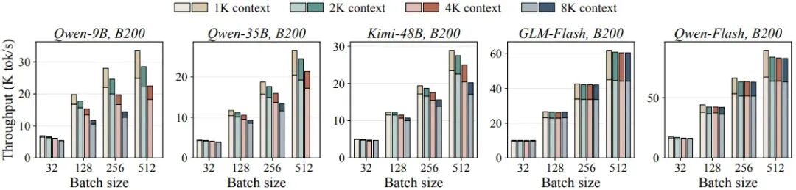

图 10：B200 GPU 上上下文长度 1K 到 8K 时，vLLM 中的解码步吞吐量。每个柱状图由 FP32 基线吞吐量（浅色）和 LeapQuant 带来的增益（深色）堆叠组成。该图验证了不同上下文长度下加速效果的稳定性，随着上下文从 1K 增长到 8K，LeapQuant 的加速比略有下降但始终保持显著正向。加速比小幅下降的原因是混合模型中的全注意力层开销随上下文增长而提升，线性注意力占比略有降低。但即使在 8K 上下文下，加速效果依然明显，说明方案在常见上下文长度范围内都能稳定生效，适配各类长场景推理需求。

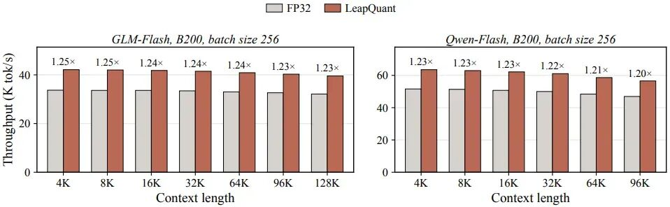

图 11：B200 GPU 上批次大小 256 时，两个稀疏注意力模型在长上下文下的解码步吞吐量。针对采用稀疏注意力的新一代混合模型，该图验证了超长上下文场景下的性能表现，上下文长度最高可达 128K。LeapQuant 在 96K 和 128K 超长上下文下依然保持稳定加速比，没有因为上下文长度激增而下降。因为稀疏注意力的开销不随上下文线性增长，线性注意力的状态开销始终是解码阶段的重要组成部分。这说明 LeapQuant 能够适配最新的稀疏 + 线性混合架构，在超长上下文场景下依然具备效率优势。

显存方面，LeapQuant 将每个状态元素的存储从 4 字节压缩到 1.19 字节，包含 INT8 残差、平滑系数和补偿 Token，**整体压缩比达到 3.4 倍。在前缀缓存场景下，端到端显存占用最高下降 56%，单卡可承载的并发请求数最多提升 1.4 倍。**

端到端推理吞吐量上，B200 提升 1.23–1.60 倍，RTX PRO 6000 提升 1.31–1.65 倍，平均端到端加速 1.47 倍。由于模型中还包含全连接层、标准注意力层等未优化组件，端到端加速比内核级低，但依然是非常可观的收益。

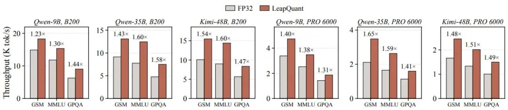

图 9：不同数据集上的端到端推理吞吐量。端到端吞吐量是实际部署中最核心的性能指标，该图覆盖三类典型任务，在两款 GPU 上都实现了 1.23–1.65 倍的吞吐量提升。提升来自两方面叠加：一是解码计算速度加快，二是内存占用降低可以支持更多并发请求。这一结果证明 LeapQuant 不仅能提升计算效率，还能通过内存优化提升服务并发能力，对于实际大模型服务部署具备很高的实用价值。

### 5.3 消融实验：每个组件的明确贡献

论文通过逐步添加组件的方式，验证了每一项设计的具体作用。

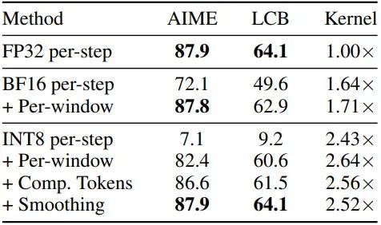

表 2：LeapQuant 各组件在 Qwen3.5-9B 上的消融实验。逐 token INT8 的 AIME 精度只有 7.1%，加上逐窗口量化直接升到 82.4%，再加补偿 Token 到 86.6%，最后加平滑完全追平 FP32 的 87.9%，同时内核速度达到 FP32 的 2.52 倍。每一个组件都带来了明确的精度提升，同时整体依然保持着显著的性能优势。

从消融结果可以清晰看到各组件的贡献：**逐窗口量化是最大的功臣，将 INT8 的 AIME 精度从 7.1% 拉到 82.4%；补偿 Token 进一步提升到 86.6%；残差平滑补上最后一步，完全追平 FP32 的 87.9%。** 完整的 8 位方案依然保持了 2.52 倍的内核加速，性价比极高。

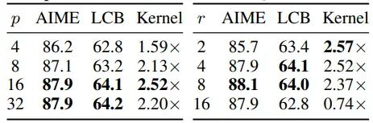

表 3：窗口长度 p 和补偿 Token 数量 r 在 Qwen3.5-9B 上的消融实验结果。该组超参数消融实验为部署参数选择提供了依据。窗口长度 p 维度，是精度与效率的最优平衡点：p 过小则量化次数多，误差累积明显且加速收益有限；p 过大则窗口内缓存更新的开销上升，反而降低吞吐量。补偿 Token 数量 r 维度，即可达到最优精度，r 继续增加精度提升微乎其微，但计算开销明显上升，时甚至会因额外开销过大导致吞吐量下降。实验同时验证了方案的参数鲁棒性，合理范围内都能取得兼顾精度与效率的效果。

窗口大小和补偿 Token 数量的消融也验证了参数选择的合理性。时精度和性能达到最优平衡点，时精度饱和，继续增加不会有收益反而会拖累性能。

整体看下来，**LeapQuant 在精度近无损的前提下，同时实现了内核速度、解码吞吐量和显存占用的三重显著提升，并且在不同模型架构、不同硬件、不同上下文长度下都有稳定的收益**。实验数据充分验证了这套方案的有效性和实用性。

## 六、总结与展望：线性注意力量化的落地意义与未来方向

LeapQuant 这项工作，本质上是给高速发展的线性注意力架构补上了推理服务端的关键一块。**在此之前，线性注意力虽然有长上下文的优势，但循环状态的访存和显存开销一直没有得到很好的解决，量化方案更是处于空白状态。**

LeapQuant 用一套完全免训练、无模型侵入的方案，第一次实现了线性注意力循环状态的 8 位近无损量化，并且已经在 vLLM 框架中完成实现，具备很强的落地可行性。

### 6.1 产业落地的核心价值

这项工作对大模型服务产业有三个层面的直接价值。

| 层面价值 | 具体说明 |
|---|---|
| 直接降低长上下文大模型的服务成本 | 当下混合架构模型的线性注意力层占比持续提升，这项优化能同时提升解码速度、降低显存占用，单卡可承载的并发请求数显著增加，直接摊薄单 token 的推理成本。 |
| 推动超长上下文的普及应用 | 此前循环状态的显存开销是前缀缓存的主要瓶颈，3.4 倍的压缩比意味着可以缓存更长的公共前缀，支撑更大的上下文窗口，为超长上下文的落地应用扫清了系统层障碍。 |
| 为端侧线性注意力模型部署提供了基础 | 端侧设备的显存带宽和容量更加紧张，低比特循环状态量化使得线性注意力模型在端侧高效运行成为可能，有望推动端侧长上下文能力的普及。 |

### 6.2 未来的优化方向

LeapQuant 打开了循环状态量化的大门，但这个方向还有很大的探索空间。

- 在比特数上，论文已经验证了 4 位量化的可行性，**未来可以进一步探索 2 位甚至更低比特的方案，进一步压缩存储和访存开销。**
- **在系统协同上，可以和前缀缓存、推测解码、分页内存管理等系统优化深度结合**，发挥协同效应，实现更大的端到端收益。
- 在架构覆盖上，目前的方案已经覆盖 GDN 和 KDA 两种主流线性注意力，**未来可以进一步延伸到 Mamba、RWKV 等更多循环式架构的状态量化**，形成通用的循环状态量化方案。

**随着混合架构大模型成为长上下文的主流选择，线性注意力的推理优化会越来越受到关注。LeapQuant 提供了一个非常扎实的起点，** 后续围绕循环状态的量化、压缩、调度优化会持续涌现，不断推高长上下文大模型的推理效率边界。

**相关推荐**

- **Attn-QAT：首个 4-bit 注意力量化感知训练，让 FP4 注意力不再掉精度，RTX 5090 上 1.1 倍至 1.5 倍加速**
- **1.25bit 登顶！腾讯开源三元量化方案 Sherry：用 3:4 稀疏榨干硬件最后一滴血，25% 位宽节省+10% 速度暴增屠榜 LLM 边缘推理**
- **突破 NVFP4 量化性能瓶颈！MIT 与 NVIDIA 提出 Four Over Six 开源方案：近 BF16 困惑度与 <2% 推理开销兼得！**
- **1.8B 模型对标顶级模型！腾讯开源 AI 端侧翻译模型：W8A8C8-FP8 量化方案，平衡极致性能与低资源适配**

---

*本文由公众号 NeuralTalk 发布于 2026 年 10 月 4 日，原文标题《LeapQuant：8 位循环状态量化近无损，线性注意力内核最高提速 3.7 倍》。本 Markdown 由原文保存，图片保存在同目录 `leapquant_weixin_images/` 文件夹下。*
