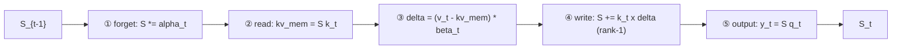

# 《Gated DeltaNet for Linear Attention》——译文与解读

> **原文**：`LLMs-from-scratch/ch04/08_deltanet/README.md`，作者 Sebastian Raschka，取自 `yanghaocsg/LLMs-from-scratch` 的 `main` 分支
> **抓取方式**：`raw.githubusercontent.com` 直链，2026-11-08，全文 4,500 tokens，`end_offset == total_length`（无截断）
> **本文结构**：第一部分是逐节译文（代码结构与变量名保持原样，仅把 `### NEW` 这类注释译成中文，避免翻译改动逻辑）；第二部分是解读——代码轴向、数字复算、与本仓 `leapquant_npu/torch-cpu/gdn.md`、`kda.md` 的口径对照、局限、对本方向的启示。

---

## 0. 结论先行

1. 这篇的真正价值不是「讲原理」，而是给了**一段可直接跑的 GDN 实现**和**一笔能自己复核的显存账**。它最有用的信息是数值口径：`α`（decay）是 **per-head 标量**，`β`（update）是 **per-channel**——这个不对称正是 GDN 与 KDA 的分界线所在。
2. 它的显存结论可以压成一个解析式（原文只给了两条公式和图）：**KV cache 与递归 state 的倍数 = 2·n_tokens / d_head**，即 `n_tokens = d_head/2` 处持平，`d_head=128` 时是 **64 个 token**。此后 state 一路占优，20K token 时是 312.5×，32K 时是 512×。
3. 那段 `for t in range(num_tokens)` 是**教学等价形式**，不是推理时的执行形式。真实 kernel 走 chunked（WY / UT 变换）并行，否则 GPU 吃不满。把它按 `L=1` 的窗口看，它就是「每步量化」的 baseline——也就是 LeapQuant 要打败的那一档。

**术语速查**：decay gate `α`（论文 `α_t`，有的实现写 `gk`，`exp(gk)=α`）／update gate `β`／delta rule（只写「真值减预测」的残差）／3:1 混合（三个线性注意力层配一个 full attention 层）。

---

## 一、译文

### 1.1 标题与开篇

**用于线性注意力的 Gated DeltaNet**

最近，Qwen3-Next 与 Kimi Linear 提出了混合式 Transformer，它们实现了注意力机制的替代方案——这类方案的复杂度随上下文长度**线性**增长，而不是二次增长。

Qwen3-Next 与 Kimi Linear 都采用 **3:1** 的比例：即每三个使用线性 Gated DeltaNet 变体的 Transformer block，配一个使用 full attention 的 block（见下文配图）。

### 1.2 引言与概览

Gated DeltaNet 是一种线性注意力变体，灵感来自循环神经网络，其中的门控机制取自 *Gated Delta Networks: Improving Mamba2 with Delta Rule* 这篇论文。某种意义上，Gated DeltaNet 就是「带 Mamba 式门控的 DeltaNet」，而 DeltaNet 本身是一种线性注意力机制。

Kimi Linear 把 Qwen3-Next 的线性注意力机制换成了 **Kimi Delta Attention（KDA）**，后者本质上是 Gated DeltaNet 的改良版。Qwen3-Next 用一个**标量门**（每个注意力头一个值）控制记忆衰减速率，Kimi Linear 则把它替换为**逐特征维度的通道级门控**。按作者的说法，这让记忆的控制更精细，从而改善长上下文推理。

此外，在 full attention 层上，Kimi Linear 用 **Multi-Head Latent Attention（MLA）** 替换了 Qwen3-Next 的 gated attention 层（后者本质上是标准多头注意力加输出门控）。这就是我们之前在 DeepSeek V3/R1 一节讨论过的 MLA，只是多了一个门。（回顾：MLA 压缩 key/value 空间以缩小 KV cache。）

Kimi Linear 里的 MLA **没有**用那个门——这是有意为之，好让作者能把架构更直接地和标准 MLA 对比；不过他们表示后续计划加上。

由于我们已经在 `../05_mla` 里实现了 MLA，本篇补充材料聚焦 Gated DeltaNet 这一侧。

### 1.3 Gated Attention（门控注意力）

在进入 Gated DeltaNet 之前，先简单说说「门」。如上图 Qwen3-Next 架构的上半部分所示，Qwen3-Next 用的是「gated attention」——本质上就是普通的 full attention 再加一个 sigmoid 门。

为了说明，作者把第 3 章的 `MultiHeadAttention` 改成下面这样：

```python
import torch
from torch import nn
class GatedMultiHeadAttention(nn.Module):
    def __init__(
        self, d_in, d_out, context_length, dropout, num_heads, qkv_bias=False
    ):
        super().__init__()
        assert d_out % num_heads == 0
        self.d_out = d_out
        self.num_heads = num_heads
        self.head_dim = d_out // num_heads
        self.W_query = nn.Linear(d_in, d_out, bias=qkv_bias)
        ####################################################
        ### 新增：加门
        self.W_gate = nn.Linear(d_in, d_out, bias=qkv_bias)
        ####################################################
        self.W_key = nn.Linear(d_in, d_out, bias=qkv_bias)
        self.W_value = nn.Linear(d_in, d_out, bias=qkv_bias)
        self.out_proj = nn.Linear(d_out, d_out)
        self.dropout = nn.Dropout(dropout)
        self.register_buffer(
            "mask",
            torch.triu(torch.ones(context_length, context_length), diagonal=1),
            persistent=False,
        )
    def forward(self, x):
        b, num_tokens, _ = x.shape
        queries = self.W_query(x)
        ####################################################
        ### 新增：加门
        gate = self.W_gate(x)
        ####################################################
        keys = self.W_key(x)
        values = self.W_value(x)
        keys = keys.view(b, num_tokens, self.num_heads, self.head_dim)
        values = values.view(b, num_tokens, self.num_heads, self.head_dim)
        queries = queries.view(b, num_tokens, self.num_heads, self.head_dim)
        keys = keys.transpose(1, 2)
        queries = queries.transpose(1, 2)
        values = values.transpose(1, 2)
        attn_scores = queries @ keys.transpose(2, 3)
        mask_bool = self.mask.bool()[:num_tokens, :num_tokens]
        attn_scores.masked_fill_(
            mask_bool, torch.finfo(attn_scores.dtype).min
        )
        attn_weights = torch.softmax(
            attn_scores / (self.head_dim ** 0.5), dim=-1
        )
        attn_weights = self.dropout(attn_weights)
        context = (attn_weights @ values).transpose(1, 2)
        context = context.reshape(b, num_tokens, self.d_out)
        ####################################################
        ### 新增：加门
        context = context * torch.sigmoid(gate)
        ####################################################
        out = self.out_proj(context)
        return out
```

（注：代码内注释保留英文原样，上面每处 `### NEW` 已标为「新增」。）

如我们所见，模型照常算完注意力后，从同一输入取一个独立的门控信号，过 sigmoid 压到 0–1 之间，再与注意力输出相乘。这让模型可以动态地放大或缩小某些特征。Qwen3-Next 的开发者表示这有助于训练稳定性：

> [...] 注意力输出门控机制有助于消除 Attention Sink 与 Massive Activation 之类的问题，保证整个模型的数值稳定性。

### 1.4 Gated DeltaNet

那么，什么是 Gated DeltaNet？Gated DeltaNet（*Gated Delta Network* 的简称）是 Qwen3-Next 的线性注意力层，意图作为标准 softmax attention 的替代。如前所述，它取自 *Gated Delta Networks: Improving Mamba2 with Delta Rule* 这篇论文。

Gated DeltaNet 最初是作为 Mamba2 的改进版提出的：把 Mamba2 的**门控衰减**机制与 **delta rule** 结合起来。

Mamba 是一种状态空间模型（Transformer 的替代方案），是个很大的话题，值得将来单独讲。

delta rule 这部分，指的是计算**新值与预测值之差**（delta，Δ），并用它去更新一个作为「记忆」使用的隐状态（后文详述）。

（旁注：熟悉经典机器学习文献的读者可以把它类比为受生物学启发的 Hebbian 学习——「一起激活的细胞连在一起」。这基本上就是感知机更新规则与基于梯度下降的学习的前身，只是没有监督信号。）

Gated DeltaNet 的门与前面 gated attention 的门类似，区别在于它用 **SiLU** 而不是 logistic sigmoid（见配图）。选 SiLU 大概是为了改善梯度流与稳定性，比标准 sigmoid 更好。

不过如上图所示，Gated DeltaNet 里的「gated」还指若干**额外的门**：

- `α`（decay gate，衰减门）控制记忆随时间衰减或重置的**快慢**；
- `β`（update gate，更新门）控制新输入对状态的**修改强度**。

在代码上，上图那个简化版（去掉卷积混合）可以这样实现（代码参考 Qwen3 团队的官方实现）。

（注：有些实现把 decay gate 称作 `gk`（第 k 步的门），其 `exp(gk)` 等于论文的 $\alpha_t$。为了让这层关系显式可见，下面的代码把对数域门 `alpha_log` 与取指数后的衰减 `alpha` 分开写。）

```python
import torch
from torch import nn
import torch.nn.functional as F
def l2norm(x, dim=-1, eps=1e-6):
    return x * torch.rsqrt((x * x).sum(dim=dim, keepdim=True) + eps)
class GatedDeltaNet(nn.Module):
    def __init__(
        self, d_in, d_out, dropout, num_heads, qkv_bias=False
    ):
        super().__init__()
        assert d_out % num_heads == 0
        self.d_out = d_out
        self.num_heads = num_heads
        self.head_dim = d_out // num_heads
        self.W_query = nn.Linear(d_in, d_out, bias=qkv_bias)
        self.W_key = nn.Linear(d_in, d_out, bias=qkv_bias)
        self.W_value = nn.Linear(d_in, d_out, bias=qkv_bias)
        ####################################################
        ### 新增：delta rule 与输出门控所需的门
        self.W_gate = nn.Linear(d_in, d_out, bias=False)
        self.W_beta = nn.Linear(d_in, d_out, bias=False)
        # 注：decay gate alpha 对应
        # A_log + W_alpha(x) + dt_bias
        self.W_alpha = nn.Linear(d_in, num_heads, bias=False)
        self.dt_bias = nn.Parameter(torch.ones(num_heads))
        A_init = torch.empty(num_heads).uniform_(0, 16)
        self.A_log = nn.Parameter(torch.log(A_init))
        # 也可以写成
        # W_alpha = nn.Linear(d_in, num_heads, bias=True)
        # 但这里把 bias 拆开是为了可解释性，
        # 以及对齐官方实现
        self.norm = nn.RMSNorm(self.head_dim, eps=1e-6)
        ####################################################
        self.out_proj = nn.Linear(d_out, d_out)
        self.dropout = nn.Dropout(dropout)
    def forward(self, x):
        b, num_tokens, _ = x.shape
        queries = self.W_query(x)
        keys = self.W_key(x)
        values = self.W_value(x)
        ####################################################
        ### 新增：计算 delta rule 的两个门
        beta = torch.sigmoid(self.W_beta(x))
        alpha_log = -self.A_log.exp().view(1, 1, -1) * F.softplus(
            self.W_alpha(x) + self.dt_bias
        )
        alpha = alpha_log.exp()
        gate = self.W_gate(x)
        ####################################################
        keys = keys.view(b, num_tokens, self.num_heads, self.head_dim)
        values = values.view(b, num_tokens, self.num_heads, self.head_dim)
        queries = queries.view(b, num_tokens, self.num_heads, self.head_dim)
        beta = beta.view(b, num_tokens, self.num_heads, self.head_dim)
        gate = gate.view(b, num_tokens, self.num_heads, self.head_dim)  # 新增
        keys = keys.transpose(1, 2)
        queries = queries.transpose(1, 2)
        values = values.transpose(1, 2)
        beta = beta.transpose(1, 2)
        ####################################################
        ### 新增：delta rule 所需的 QKNorm 式归一化
        queries = l2norm(queries, dim=-1) / (self.head_dim ** 0.5)
        keys = l2norm(keys, dim=-1)
        ####################################################
        S = x.new_zeros(b, self.num_heads, self.head_dim, self.head_dim)
        outs = []
        ####################################################
        ### 新增：门控 delta rule 的状态更新
        for t in range(num_tokens):
            k_t = keys[:, :, t]
            q_t = queries[:, :, t]
            v_t = values[:, :, t]
            b_t = beta[:, :, t]
            a_t = alpha[:, t].unsqueeze(-1).unsqueeze(-1)
            S = S * a_t
            kv_mem = (S * k_t.unsqueeze(-1)).sum(dim=-2)
            delta = (v_t - kv_mem) * b_t
            S = S + k_t.unsqueeze(-1) * delta.unsqueeze(-2)
            y_t = (S * q_t.unsqueeze(-1)).sum(dim=-2)
            ####################################################
            outs.append(y_t)
        context = torch.stack(outs, dim=2).transpose(1, 2).contiguous()
        context = context.view(b, num_tokens, self.num_heads, self.head_dim)
        ####################################################
        ### 新增：施加 RMSNorm 与 SiLU 门
        context = self.norm(context)
        context = context * F.silu(gate)
        ####################################################
        context = context.view(b, num_tokens, self.d_out)
        context = self.dropout(context)
        out = self.out_proj(context)
        return out
```

（注：为了简化，作者略去了 Qwen3-Next 与 Kimi Linear 使用的卷积混合，好让代码更易读、聚焦于循环部分。）

所以如我们所见，它与标准（或门控）注意力有大量差别。

在 gated attention 里，模型在所有 token 之间算普通注意力（每个 token 关注其它所有 token），拿到注意力输出后，再让一个门（sigmoid）决定保留多少。要点在于：**它仍然是标准的缩放点积注意力，随上下文长度二次增长**。

复习一下，缩放点积注意力的计算是 softmax(QKᵀ)V，其中 Q、K 是 *n*×*d* 矩阵，*n* 是输入 token 数，*d* 是嵌入维度。于是 QKᵀ 得到一个 *n*×*n* 的注意力矩阵，再与 *n*×*d* 的 value 矩阵相乘：

```python
attn_scores = queries @ keys.transpose(2, 3)
mask_bool = self.mask.bool()[:num_tokens, :num_tokens]
attn_scores.masked_fill_(
    mask_bool, torch.finfo(attn_scores.dtype).min
)
attn_weights = torch.softmax(
    attn_scores / (self.head_dim ** 0.5), dim=-1
)
context = (attn_weights @ values).transpose(1, 2)
context = context.reshape(b, num_tokens, self.d_out)
```

在 Gated DeltaNet 里，**没有** *n*×*n* 的注意力矩阵。模型逐个处理 token，维护一个随每个新 token 到来而更新的「运行记忆」（state）。这就是下面实现的东西，`S` 是逐个时间步 *t* 循环更新的状态：

```python
S = x.new_zeros(b, self.num_heads, self.head_dim, self.head_dim)
outs = []
for t in range(num_tokens):
    k_t = keys[:, :, t]
    q_t = queries[:, :, t]
    v_t = values[:, :, t]
    b_t = beta[:, :, t]
    a_t = alpha[:, t].unsqueeze(-1).unsqueeze(-1)
    S = S * a_t
    kv_mem = (S * k_t.unsqueeze(-1)).sum(dim=-2)
    delta = (v_t - kv_mem) * b_t
    S = S + k_t.unsqueeze(-1) * delta.unsqueeze(-2)
    y_t = (S * q_t.unsqueeze(-1)).sum(dim=-2)
```

这些门控制记忆如何变化：

- `α`（alpha）调节要忘掉多少旧记忆（衰减）；
- `β`（beta）调节当前时间步 *t* 的 token 对记忆的更新强度。

（上面这段代码里没体现的最终输出门，与 gated attention 的那个类似，控制保留多少输出。）

所以某种意义上，Gated DeltaNet 的状态更新和循环神经网络（RNN）很像。好处是通过这个 for 循环，复杂度随上下文长度**线性**增长，而不是二次。

这种循环式状态更新的代价是：相较于普通（或门控）注意力，它牺牲了全 pairwise attention 带来的**全局上下文建模能力**。Gated DeltaNet 仍能在相当程度上捕捉上下文，但必须经过记忆 `S` 这个瓶颈。记忆是固定尺寸的，因此更高效，但它像 RNN 一样把过去的上下文压进单一隐状态。

这就是为什么 Qwen3-Next 与 Kimi Linear 并没有把所有注意力层都换成 DeltaNet 层，而是采用前面提到的 3:1 比例。

### 1.5 DeltaNet 的内存节省

上一节讨论了 DeltaNet 相对 full attention 在**计算**复杂度上的优势（线性而非二次）。除计算之外，另一个大优势是**内存**：DeltaNet 模块不增长 KV cache，而是维持一个固定尺寸的递归状态，因此内存与上下文长度无关。

对标准多头注意力（MHA）层，KV cache 大小可算作：

```
KV_cache_MHA ≈ batch_size × n_tokens × n_heads × d_head × 2 × bytes
```

（乘 2 是因为 key 与 value 都要存。）

对上面实现的简化版 DeltaNet：

```
KV_cache_DeltaNet = batch_size × n_heads × d_head × d_head × bytes
```

注意 `KV_cache_DeltaNet` **不含** `n_tokens`。另外我们只存状态 `S`，不再分别存 key 和 value，所以 `2 × bytes` 变成 `bytes`。但这里出现了一个二次项 `d_head × d_head`，它来自状态的定义：

```
S = x.new_zeros(b, self.num_heads, self.head_dim, self.head_dim)
```

不过这通常不必担心，因为 head 维度一般较小——例如 Qwen3-Next 里是 128。

带卷积混合的完整版会稍复杂（涉及 kernel size 等），但上面两条公式足以说明 Gated DeltaNet 的主趋势与动机。

我们可以用下面的辅助脚本，对不同上下文长度可视化内存估计与节省：

```bash
uv run plot_memory_estimates_gated_deltanet.py \
  --emb_dim 2048 \
  --n_heads 16 \
  --n_layers 48 \
  --dtype "bf16"
```

注意上面的脚本把 `head_dim` 算作 `emb_dim / n_heads`，即 2048 / 16 = 128。

---

## 二、解读

### 2.1 代码里三个最容易读错的点

**（a）`S` 的轴向：行是 key，列是 value，即论文的 `[d_k, d_v]`**

```
kv_mem = (S * k_t.unsqueeze(-1)).sum(dim=-2)
```

`S` 是 `[b, heads, d, d]`，`k_t.unsqueeze(-1)` 是 `[b, heads, d, 1]`。PyTorch 的广播从右往左对齐，所以这个乘法沿 **dim=-2（行）** 变化、沿列不变：`S[i, j] * k[i]`。再 `sum(dim=-2)` 即 `Σ_i S[i,j] k[i]`，结果按 `j` 索引。

而写回是

```
S = S + k_t.unsqueeze(-1) * delta.unsqueeze(-2)   # S[i,j] += k[i] * delta[j]
```

`k` 变化在行、`delta` 变化在列。两侧一致 ⇒ **行 = key 维，列 = value 维**，即 `S ∈ R^{d_k × d_v}`，与论文同向。这一点很关键，因为 vllm-ascend 存的是转置（`ssm_state = [d_v, d_k]`），移植时整个读写要翻过来——我在 `gdn.md` 的「State layout」表里专门写过这条。

**（b）顺序：先衰减、再读、最后写**

```
S = S * a_t          # ① forget
kv_mem = (S * k)…    # ② read（读的是已衰减的记忆）
delta  = (v - kv_mem) * b_t   # ③ 残差
S = S + k ⊗ delta    # ④ 写回
```

如果先读后衰减，`delta` 就会相对「未衰减的旧记忆」计算，同一个 token 写回时会部分抵消自己的衰减，等价于把 α 的作用抹掉一半。这个顺序与 `gdn_torch.py::rebuild_state` 的窗口重建也对得上——那里 `p`（窗口门乘积）乘的是**旧检查点**，而窗口内缓冲项按 `∏_{i>j} γ_i` 单独衰减。



**（c）`α` 与 `β` 的粒度不对称——这条最值钱**

```
self.W_alpha = nn.Linear(d_in, num_heads, bias=False)   # 输出维度 = num_heads
self.W_beta  = nn.Linear(d_in, d_out,    bias=False)    # 输出维度 = d_out
...
alpha = alpha_log.exp()                                  # [b, tokens, heads]
beta  = torch.sigmoid(self.W_beta(x))                    # [b, tokens, d_out] → 再 view 成 per head_dim
```

也就是说：**decay 是每个头一个标量，update 是每个通道一个值**。原文正文把 GDN 描述成「标量门控」，容易让人以为两个门都是标量——实际只有 `α` 是。KDA 改的正是这个 `α`：把它从 per-head 标量变成 per-channel。这个区分刚好是我在 `kda.md` 里那句「差别只在如何遗忘」的代码级证据。

另外 `α` 的构造是 Mamba2 的离散化写法，不是 sigmoid：

```
alpha_log = -exp(A_log) * softplus(W_alpha(x) + dt_bias)   # ≤ 0
alpha     = exp(alpha_log)                                  # ∈ (0,1]
```

`exp(A_log) ∈ (0,16)` 是可学习的时间尺度（`A_init = uniform(0,16)`），`softplus` 保证输入为正，所以 `alpha_log ≤ 0` 恒成立、`alpha ∈ (0,1]` 恒成立。这比 sigmoid 多了一个可学习的「衰减速率」维度，代价多两个参数（`A_log`、`dt_bias`）。

### 2.2 数字复算（这是我的账，不是原文的）

原文只给了两条公式和一张图，没给具体数值。按它自己脚本里的配置（`emb_dim=2048, n_heads=16, n_layers=48, bf16` ⇒ `d_head=128`），batch=1、单序列，我复算如下：

| 上下文长度 n | MHA KV cache | DeltaNet state | 倍数 |
|---|---|---|---|
| 2,048 | 768 MiB | 24 MiB | 32× |
| 8,192 | 3.00 GiB | 24 MiB | 128× |
| 20,000 | 7.32 GiB | 24 MiB | 312.5× |
| 32,768 | 12.00 GiB | 24 MiB | 512× |

- DeltaNet state：`48 × 16 × 128 × 128 × 2 B = 25,165,824 B = 24 MiB`，与 n 无关。
- MHA KV：每 token 每层 `16 × 128 × 2（K,V）× 2 B = 8,192 B`，48 层合计 **384 KiB/token**；`n × 48 × 8,192`。
- 两式相除 ⇒ **倍数 = 2·n / d_head**，交叉点 `n = d_head / 2 = 64` 个 token。也就是说：上下文超过 64 个 token，固定 state 就比 KV cache 小；`d_head` 越大交叉点越晚（`d_head=256` 时要 128 token）。

**这个解析式说明了一件原文没明说的事**：DeltaNet 的内存优势不是「一直很大」，而是**随 n 线性拉开**。在短上下文（<100 token）场景，它的 state 反而比 KV cache 大——所以「省内存」这句话必须带上下文长度才成立。

再给一组我这边的口径（本仓 kernel 契约 `H=32, d=128, fp32`）：每层 state `32 × 128 × 128 × 4 B = 2 MiB`，48 层 ⇒ **96 MiB/序列**（bf16 减半）。这就是 LeapQuant 要去压的那块常驻内存。

### 2.3 与本仓 `gdn.md` / `kda.md` 的口径对照

| 维度 | 这篇 README | 本仓文档 / vllm-ascend |
|---|---|---|
| 状态布局 | `S ∈ [d_k, d_v]`（行=key，列=value） | `ssm_state = [num_slots, H, d_v, d_k]`，**转置** |
| decay 粒度 | per-head **标量**（`W_alpha: d_in→heads`） | GDN 同（标量 `p`）；KDA 换为 per-key-channel（`gbuf`/`pcum`） |
| update 粒度 | **per-channel**（`W_beta: d_in→d_out`） | 本仓 flush 契约里折进 `w`（标量）——注意这是窗口聚合后的近似 |
| state 精度 | `x.new_zeros(...)`，跟随输入（训练时 bf16） | 窗口内必须 fp32，只有检查点走 int8+fp16 |
| 计算形式 | 串行 `for t` 循环 | chunked / 窗口 flush（`L=16`）+ 边界一次量化 |
| 与 LeapQuant 的关系 | 无（成文早于该工作） | 把这段循环按 `L=1` 看，就是「每步量化」baseline，正是被比下去的那一档 |

**一个可以直接用的推论**：因为 GDN 的 `α` 是标量，整个 state 的列（key 轴）被**同一个因子**衰减，列之间的相对比例只由数据决定、不随时间漂移；KDA 才是各列按自己的节奏漂。所以 LeapQuant 的按列平滑因子 `s_k`：

- 在 GDN 上更像**静态校准**（一次估出来就够用，窗口内漂移小）；
- 在 KDA 上必须**窗口内跟踪**（衰减率不同，列幅值会分叉）。

这正好解释了 `kda_torch.py` 为什么非要 `gbuf` + `pcum` 两个额外张量、而 `gdn_torch.py` 一个标量 `w` 就够——不是实现偷懒，是数学上不可折叠。

### 2.4 需要打折的五处说法

1. **「线性」的常数被藏起来了。** 对 n 是线性，但每步是 `O(d²)` 的读 + 写，常数不小；更要紧的是这段循环**串行**，GPU 上几乎吃不满算力。真实实现走 chunked（把 L 个 token 折叠成 WY / UT 变换再做矩阵乘），原文完全没提，读者容易以为推理就这么跑。
2. **state 用 bf16 是坑。** `x.new_zeros` 继承输入 dtype，训练/推理若在 bf16，20K 步更新的累积误差不可忽视；生产实现（含本仓）明确要求 state fp32。原文没讨论这点。
3. **Hebbian 类比是修辞，不是等价。** delta rule 是「对 (k, v) 关联做一步最小二乘」的有监督修正，Hebbian 是无监督的外积累积；形式上都是 rank-1 更新，语义不同。原文自己标了「side note」，但容易被读成等价。
4. **内存账只算了一种布局、一层的一项。** 它忽略了：卷积混合的状态（每层一份短卷积缓存）、gate/alpha 的中间缓冲、分页与 CUDA graph 的额外开销，以及 prefill 阶段 chunked 变换需要的 `O(L·d)` 临时量。实际部署的常驻内存比这 24 MiB 要大。
5. **3:1 是架构事实，不是最优证据。** 两个模型都用 3:1，但这不构成「3:1 最优」的实验证据；原文措辞谨慎（只是陈述），转述时不要升级。

### 2.5 对本方向（LeapQuant / NPU）的四条启示

1. **`α`/`β` 的粒度不对称本身就是移植要点**：NPU 上 `α` 的计算是 `d_in → H`（48 层 × 16 头，极便宜），`β` 是 `d_in → d_out`（和 qkv 同量级）。做 fused 层时不要把两者当成同一类 gate 一起调度。
2. **把这篇的循环当 `L=1` 窗口**，就能对齐本仓 `verify.py` 里那条对照：「每步量化 MSE 4.93e-06 vs 每窗口 7.76e-07（6.3×）」。README 的实现天然是 per-step 量化的极端情形。
3. **状态精度差一个 dtype，泄漏的就是一个数量级**。要让这段代码能当 NPU 的数值 baseline，至少要改两处：`S` 用 fp32、循环换 chunk `L=64` 的 UT 形式。
4. **列向量的物理解释可以直接复用**：`S` 的每一列对应一个 key 通道的「value 分布」，GDN 里它们同倍衰减、KDA 里各自衰减——这正是 `s_k`（按列平滑）该不该每窗口重估的判断依据。

### 2.6 本次没做的事（明示）

- 原文 3 张配图（`01.webp` / `02.webp` / `03.webp`，来自 `sebastianraschka.com`）**未抓取**，本文只做了文字转述；如需归档图片可以再下载。
- **未逐行比对** Qwen3-Next 官方 `modular_qwen3_next.py`（原文给的 permalink 是 `0ed6d51` 版本），本文关于「与官方实现一致」的判断只基于作者自述与代码形态。
- 原文的 `plot_memory_estimates_gated_deltanet.py` **未运行**（仓库里只有脚本调用命令），上面 2.2 的数字是我按公式独立复算的，口径已写明假设。

---

## 三、出处

- 原文：`https://github.com/yanghaocsg/LLMs-from-scratch/blob/main/ch04/08_deltanet/README.md`（上游为 `rasbt/LLMs-from-scratch`）
- Gated DeltaNet 论文：`https://arxiv.org/abs/2412.06464`（*Gated Delta Networks: Improving Mamba2 with Delta Rule*）
- Kimi Linear（KDA 出处）：`https://arxiv.org/abs/2510.26692`
- Qwen3-Next 技术报告/博客：原文给的 `qwen.ai/blog?id=4074cca80393150c248e508aa62983f9cb7d27cd`
- Qwen3-Next 官方实现：`transformers/src/transformers/models/qwen3_next/modular_qwen3_next.py`（原文引用 commit `0ed6d51`）
