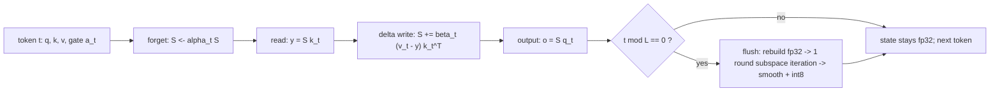

# GDN (Gated DeltaNet): The Recurrent State in Plain Terms

This note explains what the recurrent **state** is and why GDN needs it, using
a simple mental model rather than the full derivation.

## One-line idea

GDN replaces the ever-growing attention cache with one fixed-size matrix
`S` (the state) that is updated in place. It does not remember every token; it
keeps a running summary of key-to-value associations.

## What the state does

`S` is a small matrix. Think of it as a lookup table built from everything seen
so far, but compressed to a fixed size. At each new token the model does three
things, in order:

1. **Forget (gate).** Fade the old memory by a learned scalar `alpha_t`
   (between 0 and 1).
2. **Read.** See what the current key `k_t` would already predict from the
   faded memory: `alpha_t S_{t-1} k_t`.
3. **Write (delta rule).** Store only the *difference* between the real value
   and that prediction, so an old entry is edited instead of duplicated.

$$S_t = \alpha_t S_{t-1} + \beta_t\,(v_t - \alpha_t S_{t-1} k_t)\,k_t^\top$$

The answer to a query is then just the state multiplied by the query:
`o_t = S_t q_t`.

## The whiteboard metaphor

- **Softmax attention** is a stenographer who keeps every line ever said in a
  notebook that grows without bound. To answer a question, they re-read the
  whole notebook.
- **GDN's state** is a single fixed-size whiteboard. Before writing each new
  fact, the writer turns one **overall dimmer knob** (`alpha_t`) that fades
  everything on the board by the same amount, then writes the new fact. The
  board never gets bigger.
- The **delta rule** is like updating a contact's phone number: you first look
  up that name, erase the old number, and write the new one, rather than
  scribbling a second number next to it.

The single dimmer knob is the key GDN signature: one scalar gate controls how
much of the whole board is retained at each step.

## Why it matters for LeapQuant

The state is the only long-term memory in these layers, so it is exactly what
LeapQuant compresses. GDN keeps the state in fp32 and updates it every step;
LeapQuant quantizes it once per window instead, shrinking its storage while
the whiteboard's contents stay effectively the same.

## GDN vs KDA

GDN uses one scalar gate for the whole state. KDA gives each channel its own
decay (see `kda.md`); GDN is the special case where all those channel gates
happen to be equal.

---

## Inference logic (decode time, step by step)

This section turns the metaphor above into the actual call sequence the engine
performs, using the layouts this repo really uses. Everything below is
implementable with the two code paths already in the tree:

- `leapquant_npu/torch-cpu/state.py` — boundary-only encode/decode of one state
  (`encode`, `decode`, `is_window_start`, `closes_window`).
- `leapquant_exp/gdn_torch.py` — the *window flush* that also folds the
  in-window updates (`rebuild_state`, `subspace_iteration`, `quantize`, `run`).

### State layout and fixed geometry

The paper keeps `S ∈ R^{d_k × d_v}`; vllm-ascend keeps `ssm_state` as
`[num_slots, H, d_v, d_k]`, i.e. the **transpose**. Read every formula below in
that layout: `S[v, k]` is "what value channel `v` should be for key channel
`k`", so `S k_t ∈ R^{d_v}` is a prediction of `v_t`, and `S q_t` is the output.

| Item | Value / shape | Source |
| --- | --- | --- |
| heads | 32 | kernel contract |
| `d_v`, `d_k` | 128, 128 | kernel contract |
| window `L` | 16 tokens between two quantizations | `LeapQuantSpec.window` |
| compensator rank `R` | 4 | `LeapQuantSpec.compensator_tokens` |
| payload | int8 `[B,32,128,128]`, `QMAX = 127` | `state.py::encode` |
| scales | `s_k` fp32 `[B,32,128]` (per key column), `s_v` fp32 `[B,32,128]` (per value row) | `gdn_torch.py::quantize` |
| compensator | `u`, `q` fp16 `[B,32,4,128]` | `gdn_torch.py::subspace_iteration` |
| in-window buffer | `kbuf`/`ubuf` bf16 `[B,32,16,128]`, `w` fp32 `[B,32,16]`, `p` fp32 `[B,32]` | kernel contract |

Note the two scale names are **not** the usual INT8 pair: `s_k` is the *smoothing*
factor on the key axis and `s_v` is the *symmetric* per-row scale — the same
`C`/`B` decomposition as `state.py` (`scale_c`, `scale_b`), only renamed.

### One decode step

```
inputs: q_t ∈ R^d_k, k_t ∈ R^d_k, v_t ∈ R^d_v, gate a_t
1. preprocess : β_t = σ(b_t) ∈ (0,1);      α_t = exp(-softplus(a_t)) ∈ (0,1]
                q_t, k_t are L2-normalized by the layer before the recurrence
2. forget     : S ← α_t · S_{t-1}                  # the single dimmer knob
3. read       : ŷ_t = S · k_t  ∈ R^d_v             # what the faded board predicts
4. delta write: S_t = S + β_t · (v_t − ŷ_t) · k_tᵀ # rank-1 edit, not append
5. output     : o_t = S_t · q_t  ∈ R^d_v
```

Two invariants make this stable in fp32: `‖k_t‖ = 1` keeps the write a
rank-one *edit* rather than a blow-up, and the read-before-write order means the
delta is measured against the already-decayed state, so a token cannot "double
count" what it is about to overwrite.

The flush op never re-derives these — it consumes `q/k/v` already folded into
`kbuf`/`ubuf`/`w`. So normalization and gating are the **layer's** responsibility;
if your engine hands the operator unnormalized keys, the reconstruction is
still self-consistent but the decay semantics no longer match the trained model.

### Why only the window boundary is quantized

With window length `L` and a quantized boundary checkpoint `Ŝ₀`:

```
S̃_t = F_t(S̃_{t-1}),  S̃_0 = Ŝ_0 = RoundTrip(S_0),  t = 1 … L
```

Inside the window the update `F_t` runs in fp32, so quantization error enters
**once per L steps** instead of once per step, and it enters only as the
*starting point* — subsequent steps then evolve from it. This is the whole
accuracy argument, and it is exactly Eq. (4) of the paper.

### The two engine hooks

```python
is_window_start(n, L)   -> (n % L == 0) & (n > 0)     # decode from the int8 checkpoint
closes_window(n, n_new, L) -> (n + n_new) % L == 0    # flush this state before the next read
```

- `is_window_start`: the row's first token of a new window must *decode* the
  checkpoint (`state.py::decode`) instead of reusing last step's fp32 state.
  Fresh requests (`n == 0`) are excluded — the state is empty, quantizing it is
  a no-op.
- `closes_window`: after a prefill chunk or a decode step, if the count lands
  exactly on `L`, flush (`state.py::encode` or `gdn_torch.py::run`).

### Boundary flush: three steps, and where each lives

1. **Rebuild the fp32 state** (`gdn_torch.py::rebuild_state`)

   ```
   S = p · ( qᵀu + dequant(codes) )  +  Σ_{j<L} w_j · ubuf_j · kbuf_jᵀ
   ```

   `qᵀu` is the old rank-`R` compensator, `dequant(codes)` is
   `codes · s_k ⊗ s_v / 127`, and `p` is the window's **gate product**
   `∏ α_t ∈ (0,1]`. Because GDN's gate is a scalar, the per-token decay
   `∏_{i>j} α_i` can be folded into the scalar weight `w_j` — which is why the
   GDN flush needs `w` but no per-token decay tensor, while KDA needs `gbuf`.
2. **One round of subspace iteration** (`subspace_iteration`)
   `x = Sᵀ`, `qk = MGS(x q0)`, `qv = MGS(xᵀ qk)`, `u_new = (x qv)ᵀ`, all orthonormal
   by modified Gram–Schmidt applied twice; stored fp16. One round only — `q0` is
   a fixed start, not a random one, which is what makes the op deterministic.
3. **Residual smoothing + INT8** (`quantize`)
   `E = S − qᵀ_new u_new`; `s_k = sqrt(mean over v |E|)` per key column;
   `s_v = max over k |E / s_k|` per value row; `codes = round(E / (s_k s_v) · 127)`.

### Full loop (what the engine actually alternates)



Cost profile in one line: per token the work is `O(d_v d_k)` for the rank-1
write plus `O(d_v d_k)` for the read — the state is 128×128 per head, so the
steady state is dominated by HBM traffic, and that is precisely the traffic
LeapQuant removes by keeping the *payload* 8-bit and only paying fp32 once per
16 steps.

### What the fp32 path must preserve

- The in-window state must stay fp32 (or bf16 at worst); storing the running
  state in int8 between steps defeats Eq. (4) and turns per-window error back
  into per-step error.
- `p` must be the **product** of the window's gates, not the last gate; taking
  the last gate silently drops the rest of the decay.
- `q0` must be the same fixed matrix at every flush; changing it breaks
  reproducibility across steps (and the kernel's accuracy criterion).
- The compensator is worth ~0.008 of the state norm (measured on the 32×32
  smoke test), i.e. small but not negligible — dropping `R` costs accuracy
  roughly back to the INT8-only number (`MSE 2.48e-2` → `1.39e-3` with `R=4`
  and smoothing).
