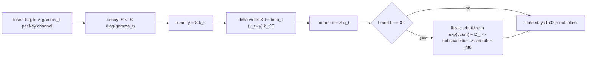

# KDA (Kimi Delta Attention): The Recurrent State in Plain Terms

KDA, short for **Kimi Delta Attention**, is an extension of Gated DeltaNet.
Like GDN it keeps one fixed-size recurrent state `S`; the difference is how
that memory is forgotten.

## One-line idea

KDA replaces GDN's single scalar forgetting gate with a **per-channel decay**,
so each memory channel can be retained or erased on its own schedule. This
uses the limited state memory more efficiently.

## What the state does

The state is still a fixed-size matrix holding compressed key-to-value
associations, and each token still follows forget, read, write. The change is
in step 1:

1. **Forget (channel-wise).** Instead of one scalar `alpha_t` for the whole
   matrix, KDA applies a diagonal decay `D_t` whose entries can differ per
   channel. Some channels keep their content; others fade quickly.
2. **Read.** The current key reads the decayed memory, as in GDN.
3. **Write (delta rule).** Only the residual between the target value and the
   read prediction is written, so entries are edited, not duplicated.

Conceptually, with the channel-wise decay in place of the scalar:

$$S_t = D_t S_{t-1} + \text{(delta-rule write for } k_t, v_t\text{)}$$

The output is again the state multiplied by the query, `o_t = S_t q_t`.

## The whiteboard metaphor

- Recall GDN's whiteboard with one **overall dimmer knob** that fades the
  entire board by the same amount each step.
- KDA upgrades that board so **each column (each channel) has its own dimmer
  knob**. The region holding durable facts can stay bright while the region
  holding throwaway details is dimmed aggressively, independently.
- It is the difference between a single room light and separate lights over
  each work zone: finer control means the fixed board is spent on the channels
  that actually need it.

This per-channel control is the key KDA signature and why it can hold more
useful associations than GDN within the same state size.

## Why it matters for LeapQuant

KDA appears in large hybrid models (such as Kimi K3) alongside full-attention
layers, and its state is the fixed-size long-term memory of those KDA layers.
LeapQuant compresses exactly this state once per window. Because KDA already
organizes memory by channel, the per-channel scales line up naturally with
LeapQuant's row/column quantization factors.

## KDA vs GDN

- GDN: one scalar gate decays the whole state uniformly.
- KDA: a diagonal, per-channel decay controls each channel separately.
- When all of KDA's channel factors are equal, it reduces to GDN.

---

## Inference logic (decode time, step by step)

Same call sequence as GDN (see `gdn.md`), with one substitution that changes
both the math and the operator's interface. Code paths in the tree:
`leapquant_npu/torch-cpu/state.py` (boundary encode/decode) and
`leapquant_exp/kda_torch.py` (`rebuild_state`, `decay_matrix`,
`subspace_iteration`, `quantize`, `run`).

### State layout and geometry

Identical to GDN: `ssm_state` is `[num_slots, H, d_v, d_k]`, heads 32,
`d_v = d_k = 128`, window `L = 16`, compensator rank `R = 4`, int8 payload
`[B,32,128,128]` with `QMAX = 127`. The paper's `S ∈ R^{d_k × d_v}` is again the
transpose of the stored layout.

What changes: the gate becomes a vector over the **key** axis, and the operator
grows two inputs.

| Input | Shape / dtype | Meaning |
| --- | --- | --- |
| `gbuf` | fp16 `[B,32,16,128]`, entries in `(0,1]` | per-token, per-key-channel decay factor `γ_t` |
| `pcum` | fp32 `[B,32,128]`, cumulative non-positive log-gates | `Σ_t log γ_t` over the window; checkpoint decay is `exp(pcum)` |

GDN's scalar `p` disappears: a per-channel decay cannot be folded into a scalar,
which is exactly why the interface gains two tensors.

### One decode step, complete form

With `γ_t ∈ (0,1]^{d_k}` and `diag(γ_t)` on the key axis:

$$S_t = S_{t-1}\,\mathrm{diag}(\gamma_t) + \beta_t\,\bigl(v_t - S_{t-1}\,\mathrm{diag}(\gamma_t)\,k_t\bigr)\,k_t^\top$$

Read as five machine steps:

```
1. decay  : S ← S · diag(γ_t)          # each key column fades on its own schedule
2. read   : ŷ_t = S · k_t  ∈ R^d_v     # equivalently (γ_t ⊙ k_t) against the un-decayed S
3. delta  : S_t = S + β_t (v_t − ŷ_t) k_tᵀ   # same rank-1 edit as GDN
4. output : o_t = S_t · q_t
5. repeat : order matters — decay before read, so the residual is measured
            against the decayed memory, not the old one
```

Step 1 is where the two operators diverge and it is the only divergence: set
`γ_t = α_t · 1` and the formula collapses term by term into GDN's.
`diag(γ_t)` acting on the key axis is the same axis the "each column has its
own dimmer" metaphor refers to — one scalar per key channel, shared across all
value rows of that column.

### Windowed quantization

Unchanged in structure: fp32 inside the window, one round-trip at the boundary
(Eq. (4) of the paper). The hooks `is_window_start` / `closes_window` are
gate-agnostic — `n % L == 0` and `(n + n_new) % L == 0` — so the same two
insertion points serve GDN and KDA.

### Boundary flush

1. **Rebuild** (`kda_torch.py::rebuild_state`)

   ```
   S = ( qᵀu + dequant(codes) ) · diag(exp(pcum))  +  Σ_{j<L} w_j · ubuf_j · (kbuf_j ⊙ D_j)ᵀ
   D_j = ∏_{i>j} γ_i          # (decay_matrix: reverse cumprod, shifted by one)
   ```

   The checkpoint — everything older than this window — has decayed by the full
   window product `exp(pcum)` on each key column. Buffered token `j` has decayed
   by the product of the gates **after** it, `∏_{i>j} γ_i`, not by `exp(pcum)`;
   that off-by-one is what `decay_matrix` implements (reverse cumulative
   product, then shift by one and pad the last entry with 1).

2. **One round of subspace iteration** → new `u_new`/`q_new` (fp16), same
   modified-Gram–Schmidt-twice construction as GDN.
3. **Residual smoothing + INT8** → `E = S − qᵀ_new u_new`, `s_k = sqrt(mean over v |E|)`
   per key column, `s_v = max over k |E/s_k|` per value row, `codes = round(E/(s_k s_v)·127)`.

### Full loop



### Where KDA's cost differs from GDN's

- The step-1 decay is `d_v × d_k` element scaling on 128 columns instead of
  multiplying the whole matrix by one scalar — same bytes touched, but it cannot
  be folded into a scalar, so it must read `γ_t` per channel each step.
- `gbuf` is fp16 and `pcum` fp32: the decay factors themselves are quantized to
  fp16, so small per-step decays lose relative precision long before the state
  does. `pcum` is kept in fp32 for exactly that reason — the window product is
  accumulated as a **sum of logs**, never as a product of 16 fp16 numbers.
- `exp(pcum)` underflows to 0 for long windows or aggressive gates. That is
  benign for the checkpoint (its contribution is then genuinely gone) but it
  must not produce NaN downstream; the reference clamps scales with `eps`.

### Why KDA is the friendlier case for LeapQuant

Its decay already lives on the key axis, one factor per column — the same axis
and the same granularity as the smoothing factor `s_k` (per key column) and the
per-row scale `s_v`. The quantizer therefore inherits a decomposition the
operator was already using, instead of imposing one: the decayed columns are
precisely the columns whose magnitude `s_k` normalizes before INT8.
